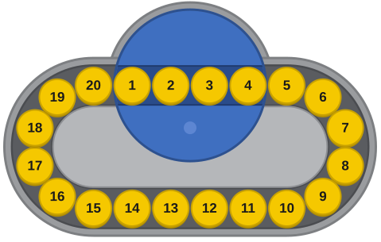

# TopSpinSolver

Solves any position of the 20-token TopSpin puzzle, in Wolfram Language with an optional C two-phase solver.



- `src/wolfram/TopSpin.wl`: `TopSpinSolve[state]` returns the moves, `TopSpinApply[state, moves]` replays them. [Docs](docs/TopSpin.md).
- `src/c/topspin_twophase/`: the C two-phase solver behind `Method -> "TwoPhase"`. [Docs](docs/TopSpinTwoPhase.md).
- `test/wolfram/TopSpin.wlt`: `VerificationTest` cases.

Build the C library (goes to the gitignored `build/`, where `TopSpin.wl` looks for it):

```bash
cmake -S src/c/topspin_twophase -B build/topspin_twophase -DCMAKE_BUILD_TYPE=Release
cmake --build build/topspin_twophase --config Release
```

Run the tests from a Wolfram kernel in this folder:

```wolfram
TestReport["test/wolfram/TopSpin.wlt"]
```

The C library's first call writes uild/topspin_pairing.bin (655 MB, about 2 minutes) and uses about 1.7 GB. Its reproducible mode (limit < 0) must give the same moves on any thread count, which the pinned lengths in TopSpin.wlt depend on. Not built in CI.
